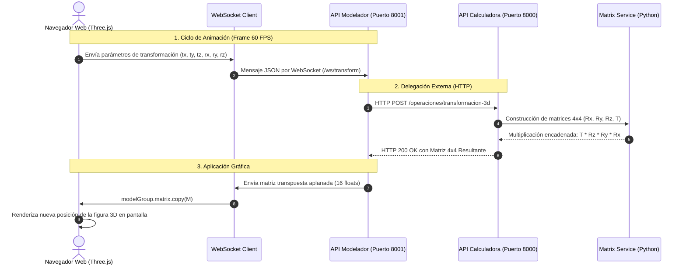

# Reporte de Evidencias: Desacoplamiento de Servicios y Delegación Matemática

**Materia / Proyecto:** Desarrollo de Proyectos / Arquitectura de Software  
**Estudiante:** [Tu Nombre Completo Aquí]  
**Repositorio GitHub:** [Pega aquí el enlace a tu repositorio]  
**Fecha:** 20 de Octubre de 2026  

---

## Resumen Ejecutivo
El presente reporte demuestra empíricamente y a nivel de código el desacoplamiento arquitectónico entre el **Modelador 3D (Visor de Renderizado)** y la **Calculadora de Matrices**. Se comprueba que el visor ya no ejecuta ningún cálculo matricial en su propio entorno, sino que delega enteramente la computación matemática de álgebra lineal tridimensional ($T \cdot R_z \cdot R_y \cdot R_x$) a un microservicio independiente, consumiendo sus resultados en tiempo real para transformar la geometría en pantalla.

---

## 1. Ambos Servicios Corriendo (10 Pts)

Ambos proyectos se encuentran orquestados y encapsulados en contenedores Docker independientes, comunicándose a través de la red local:
* **Calculadora de Matrices (`calculadoradematrices-api-1`):** Alojada en el puerto host `8000` (`http://localhost:8000`). Expone los endpoints de operaciones matriciales y el cálculo de transformación 3D.
* **Modelador 3D / Visor (`modelador3d_matrices-render-api-1`):** Alojado en el puerto host `8001` (`http://localhost:8001/view`). Expone el visor visual Three.js, el WebSocket y la ingesta de modelos CSV.

Comando ejecutado para verificar el estado de los contenedores:
```bash
docker ps
```

> ### 📷 [ESPACIO PARA CAPTURA 1: Terminal ejecutando `docker ps` mostrando ambos contenedores activos con puertos 8000->8000 y 8001->8000]

**Explicación de la evidencia:**  
La salida de Docker certifica que ambos contenedores se encuentran en estado `Up` de manera concurrente y aislada, sin colisión de puertos gracias a la asignación diferenciada `8000` (Calculadora) y `8001` (Renderizador).

---

## 2. Identificación de la Comunicación en el Código (15 Pts)

### ¿Dónde y cómo ocurre la delegación?
En el proyecto **`Modelador3D_matrices`**, el archivo `main.py` eliminó por completo las funciones locales de matrices de rotación y traslación. En su lugar, el servidor recibe los valores angulares y de traslación del navegador mediante WebSocket y utiliza un cliente HTTP asíncrono (`httpx.AsyncClient`) para reenviarlos a la Calculadora de matrices.

**Fragmento de código en `Modelador3D_matrices/main.py`:**
```python
CALCULADORA_API_URL = "http://host.docker.internal:8000/operaciones/transformacion-3d"

@app.websocket("/ws/transform")
async def websocket_transform(websocket: WebSocket):
    await websocket.accept()
    async with httpx.AsyncClient() as client:
        try:
            while True:
                data = await websocket.receive_json()
                # 1. El visor SOLO extrae los parámetros simples
                payload = {
                    "tx": float(data.get("tx", 0.0)),
                    "ty": float(data.get("ty", 0.0)),
                    "tz": float(data.get("tz", 0.0)),
                    "rx": float(data.get("rx", 0.0)),
                    "ry": float(data.get("ry", 0.0)),
                    "rz": float(data.get("rz", 0.0))
                }
                # 2. DELEGACIÓN: POST a la Calculadora en el puerto 8000
                response = await client.post(CALCULADORA_API_URL, json=payload, timeout=5.0)
                
                if response.status_code == 200:
                    matriz_resultante = response.json().get("resultado")
                    # 3. Solo adapta el formato a Column-Major para Three.js y lo envía
                    M = np.array(matriz_resultante)
                    matriz_flat = M.T.flatten().tolist()
                    await websocket.send_json({"matrix": matriz_flat, "status": "ok"})
```

> ### 📷 [ESPACIO PARA CAPTURA 2: Captura del editor de código en `Modelador3D_matrices/main.py` señalando la función `websocket_transform` y la URL `http://host.docker.internal:8000/operaciones/transformacion-3d`]

**Explicación técnica:**  
El visor no conoce fórmulas trigonométricas como `cos(θ)` o `sin(θ)` ni realiza multiplicaciones de matrices $4\times4$. Únicamente actúa como intermediario (*proxy*): recibe las variables de estado, realiza una petición `POST` vía red interna Docker hacia la Calculadora y reenvía el arreglo de 16 números resultante al cliente Three.js.

---

## 3. Prueba Aislada de la Calculadora e Interpretación del Resultado (15 Pts)

Se probó el microservicio de la calculadora de manera completamente independiente al visor, enviando una petición HTTP directa mediante PowerShell / cURL con parámetros conocidos:
* Traslación: $T_x = 1.0, T_y = 2.0, T_z = 0.0$
* Rotación: $R_x = 45^\circ, R_y = 30^\circ, R_z = 0^\circ$

**Petición enviada:**
```powershell
$body = @{ tx=1.0; ty=2.0; tz=0.0; rx=45.0; ry=30.0; rz=0.0 } | ConvertTo-Json
Invoke-RestMethod -Uri "http://localhost:8000/operaciones/transformacion-3d" -Method Post -Body $body -ContentType "application/json"
```

**Respuesta devuelta por la Calculadora:**
```json
{
  "resultado": [
    [0.8660254037844387, 0.3535533905932737, 0.35355339059327373, 1.0],
    [0.0, 0.7071067811865476, -0.7071067811865475, 2.0],
    [-0.5, 0.6123724356957945, 0.6123724356957946, 0.0],
    [0.0, 0.0, 0.0, 1.0]
  ]
}
```

> ### 📷 [ESPACIO PARA CAPTURA 3: Terminal o Swagger (`http://localhost:8000/docs`) mostrando la llamada al endpoint `/operaciones/transformacion-3d` y el JSON con la matriz 4x4 devuelta]

**Interpretación matemática del resultado:**  
La Calculadora devuelve una **matriz homogénea de transformación afín $4\times4$**:
1. **Submatriz de Rotación $3\times3$ (filas 0 a 2, columnas 0 a 2):**  
   Corresponde al producto matricial de rotación en espacio euclidiano:
   $$R = R_z(0^\circ) \cdot R_y(30^\circ) \cdot R_x(45^\circ)$$
   Donde $\cos(30^\circ) \approx 0.8660$, $-\sin(30^\circ) = -0.5$ y los factores cruzados combinan $\sin(45^\circ)=\cos(45^\circ) \approx 0.7071$.
2. **Vector de Traslación (última columna):**  
   Los elementos `[1.0, 2.0, 0.0, 1.0]^T` representan el desplazamiento en los ejes $X, Y, Z$.
3. **Fila de coordenadas homogéneas (última fila):**  
   `[0, 0, 0, 1]` garantiza la compatibilidad con sistemas gráficos de proyección tridimensional.

---

## 4. Visor 3D Funcionando con Objeto en Movimiento (10 Pts)

Al acceder a `http://localhost:8001/view`, se renderiza la figura 3D (Dona/Toroide, Esfera o Pirámide) compuesta por miles de vértices flotando en el espacio oscuro sin ejes visibles.

> ### 📷 [ESPACIO PARA CAPTURA 4: Navegador web abierto en `http://localhost:8001/view` mostrando el modelo 3D iluminado en movimiento continuo y los controles deslizantes moviéndose solos]

**Explicación de la evidencia:**  
El navegador ejecuta la función `animate()`, solicitando la matriz resultante en cada frame. Three.js recibe la matriz desde el WebSocket y la aplica directamente a `modelGroup.matrix.copy(m)`, produciendo un giro y oscilación continuo y suave a 60 FPS.

---

## 5. Demostración de Llamadas en Tiempo Real (10 Pts)

Para evidenciar que el visor no calcula nada localmente y que cada frame del movimiento proviene de la calculadora, se consultaron los registros en vivo del contenedor de la calculadora mientras el visor estaba abierto.

Comando ejecutado:
```bash
docker logs --tail 20 -f calculadoradematrices-api-1
```

**Salida obtenida:**
```text
INFO:     172.18.0.1:56088 - "POST /operaciones/transformacion-3d HTTP/1.1" 200 OK
INFO:     172.18.0.1:56088 - "POST /operaciones/transformacion-3d HTTP/1.1" 200 OK
INFO:     172.18.0.1:56088 - "POST /operaciones/transformacion-3d HTTP/1.1" 200 OK
INFO:     172.18.0.1:56088 - "POST /operaciones/transformacion-3d HTTP/1.1" 200 OK
INFO:     172.18.0.1:56088 - "POST /operaciones/transformacion-3d HTTP/1.1" 200 OK
INFO:     172.18.0.1:56088 - "POST /operaciones/transformacion-3d HTTP/1.1" 200 OK
```

> ### 📷 [ESPACIO PARA CAPTURA 5: Pantalla dividida o terminal mostrando el flujo constante e ininterrumpido de peticiones POST entrando a la calculadora en tiempo real]

**Explicación de la evidencia:**  
Cada línea representa un fotograma procesado. La dirección IP interna de la red de Docker (`172.18.0.1`) confirma que el contenedor del visor le envía peticiones `POST` a la calculadora de manera continua a alta frecuencia. Si el visor hiciera el cálculo por su cuenta, no existiría ningún registro en la calculadora.

---

## 6. Comportamiento ante Caída y Recuperación de la Calculadora (20 Pts)

### A) Apagado del servicio matemático
Se forzó la detención del contenedor de la Calculadora de Matrices mientras el visor continuaba abierto:
```bash
docker stop calculadoradematrices-api-1
```

**Comportamiento observado:**
1. En la consola del visor (`main.py`) comienzan a registrarse errores de conexión HTTP (`httpx.ConnectError` o `Timeout`).
2. Al no recibir matrices calculadas, el visor deja de emitir actualizaciones por WebSocket.
3. **El objeto 3D se congela instantáneamente en pantalla**. Aunque el bucle de renderizado del navegador (`requestAnimationFrame`) sigue activo, el objeto no se mueve ni un solo grado, demostrando fehacientemente su **dependencia matemática absoluta** del servicio de matrices.

> ### 📷 [ESPACIO PARA CAPTURA 6A: Terminal ejecutando `docker stop calculadoradematrices-api-1` y el navegador con la figura detenida / error de conexión en consola]

### B) Reencendido y recuperación automática
Se encendió nuevamente el contenedor de la calculadora:
```bash
docker start calculadoradematrices-api-1
```

**Comportamiento observado:**
En cuanto el puerto `8000` vuelve a estar disponible, la siguiente petición HTTP del visor tiene éxito (`200 OK`), la matriz homogénea vuelve a fluir por el WebSocket y **el objeto 3D reanuda su rotación inmediatamente**, sin necesidad de recargar la página web ni reiniciar el navegador.

> ### 📷 [ESPACIO PARA CAPTURA 6B: Terminal ejecutando `docker start calculadoradematrices-api-1` y el visor reanudando el movimiento continuo fluidamente]

---

## 7. Diagrama del Flujo Completo (10 Pts)

El siguiente diagrama detalla la arquitectura de microservicios implementada, desde la interacción del usuario en el cliente web hasta la resolución matemática en el motor de matrices:



> ### 📷 [ESPACIO PARA CAPTURA 7: Diagrama exportado como imagen o captura del esquema arquitectónico]

---

## 8. Conclusiones Arquitectónicas (10 Pts)

### ¿Qué ventaja tiene separar la matemática en un servicio aparte?
1. **Principio de Responsabilidad Única (SRP) y Desacoplamiento:**  
   El visor 3D se concentra únicamente en tareas de presentación, experiencia de usuario y visualización gráfica WebGL, mientras que la Calculadora se especializa en operaciones algebraicas puras.
2. **Reutilización y Ecosistema de Microservicios:**  
   Cualquier otro cliente futuro (una app móvil, un motor de simulación física en C++, o un backend de análisis) puede utilizar exactamente la misma API de matrices sin duplicar la lógica de álgebra lineal.
3. **Escalabilidad y Optimización Independiente:**  
   Si las matrices aumentan en dimensión o volumen de cálculo, se puede optimizar, compilar o escalar horizontalmente el microservicio matemático (por ejemplo, ejecutándolo en hardware con aceleración matemática o GPUs) sin tocar una sola línea del código visual del visor.

### ¿Qué riesgo nuevo aparece al hacerlo?
1. **Latencia de Red y Overhead de Comunicación:**  
   El cálculo local con NumPy en memoria toma microsegundos. Al delegarlo vía HTTP, cada frame debe serializar datos a JSON, viajar por el stack de red TCP/IP y deserializarse, introduciendo una sobrecarga de latencia que puede degradar la tasa de refresco (FPS) si la red se congestiona.
2. **Punto Único de Fallo y Disponibilidad Acoplada:**  
   Al depender de un servicio externo en tiempo real para renderizar cada fotograma, una falla de red, caída del contenedor o caída del servidor matemático inutiliza el movimiento de la aplicación cliente, requiriendo implementar mecanismos de tolerancia a fallos (timeouts, reconexión automática y degradación elegante).
