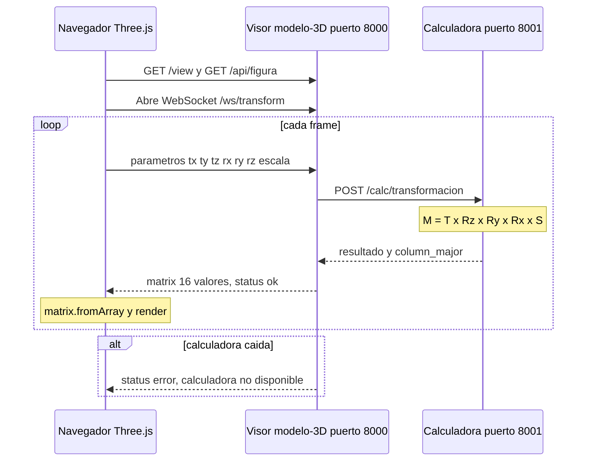

# Reporte: el visor 3D delega la matemática a la calculadora de matrices

**Autora:** Gianina Casanova
**Repositorio:** [Ninacruz25/calculadora](https://github.com/Ninacruz25/calculadora)

**Objetivo:** demostrar que el visor 3D (`modelo-3D`) ya no calcula matrices por sí mismo. Delega la matemática a `calculadora_matrices` y usa la matriz que ésta devuelve para mover el objeto.

> Las capturas van en `evidencias/` (ver `📷` en cada paso). Reemplaza cada marcador con tu captura antes de exportar a PDF.

---

## Paso 1. Ambos servicios corriendo

Se levantan desde la raíz del repo con un solo `docker-compose.yaml`:

```bash
cd desarollo_III
docker compose up --build
docker compose ps
```

| Servicio | Contenedor | Puerto host | Rol |
|---|---|---|---|
| `calculadora` | `calculadora_matrices` | **8001** | Hace las matemáticas |
| `modelo3d` | `modelo-3D` | **8000** | Visor, WebSocket y datos de figuras |

`modelo3d` declara `depends_on: calculadora` y `CALC_URL=http://calculadora:8000`.

📷 `evidencias/01_docker_ps.png`: salida de `docker compose ps` con los dos servicios `Up`.
📷 `evidencias/01_health.png`: `http://localhost:8001/health` → `{"status":"ok"}` y `http://localhost:8000/` → `"status":"online"`.

**Explicación:** son dos contenedores independientes, cada uno con su propio proceso Uvicorn. Se comunican por la red interna de Docker usando el nombre del servicio.

---

## Paso 2. Dónde el visor llama a la calculadora

Archivo [`modelo-3D/main.py`](modelo-3D/main.py):

```python
CALC_URL = os.getenv("CALC_URL", "http://localhost:8001")          # línea 16

app.state.calc = httpx.AsyncClient(base_url=CALC_URL, timeout=2.0)  # lifespan

async def pedir_transformacion(client, parametros):
    response = await client.post("/calc/transformacion", json=parametros)
    response.raise_for_status()
    return response.json()["column_major"]                           # 16 floats
```

Y el endpoint WebSocket `/ws/transform` lo usa en cada mensaje:

```python
data = await websocket.receive_json()
parametros = {k: float(data.get(k, ...)) for k in ("tx","ty","tz","rx","ry","rz","escala")}
matrix_4x4 = await pedir_transformacion(client, parametros)   # <- llamada a la calculadora
await websocket.send_json({"matrix": matrix_4x4, "status": "ok"})
```

En el navegador, [`modelo-3D/index.html`](modelo-3D/index.html) solo envía parámetros (ángulos, traslación, escala) y aplica la matriz recibida:

```js
ws.send(JSON.stringify({ tx, ty:0, tz:0, rx: angle, ry: angle*0.5, rz:0, escala }));
...
modelGroup.matrix.fromArray(data.matrix);   // matriz calculada por la calculadora
```

**Cómo funciona la comunicación:**

1. El navegador abre un WebSocket con el visor y envía parámetros de movimiento.
2. El visor reenvía esos parámetros por **HTTP POST** a `calculadora:8000/calc/transformacion`, con un cliente `httpx` reutilizado (conexiones persistentes) y un timeout de 2 s.
3. La calculadora construye `M = T · Rz · Ry · Rx · S` ([`services.transformacion`](calculadora_matrices/services/services.py)) y la devuelve por filas (`resultado`) y aplanada en Column-Major (`column_major`).
4. El visor reenvía `column_major` al navegador, que la carga con `matrix.fromArray()`.

El visor **no tiene ninguna función de rotación, traslación ni multiplicación de matrices**. Solo tiene `pedir_transformacion`. `modelGroup.matrixAutoUpdate = false` evita que Three.js calcule la matriz localmente.

📷 `evidencias/02_codigo_visor.png`: `pedir_transformacion` en `modelo-3D/main.py`.
📷 `evidencias/02_codigo_calculadora.png`: `calc_transformacion` en `calculadora_matrices/main.py`.

---

## Paso 3. La calculadora probada por sí sola

Sin el visor, directamente con `curl` (o en `http://localhost:8001/docs`):

```bash
curl -X POST http://localhost:8001/calc/transformacion \
  -H "Content-Type: application/json" \
  -d '{"tx":1,"ty":0,"tz":0,"rx":0,"ry":0,"rz":90,"escala":2}'
```

Resultado esperado (valores ≈ 0 pueden aparecer como `1.2e-16` por punto flotante):

```json
{
  "resultado": [[0,-2,0,1],
                [2, 0,0,0],
                [0, 0,2,0],
                [0, 0,0,1]],
  "column_major": [0,2,0,0, -2,0,0,0, 0,0,2,0, 1,0,0,1]
}
```

**Explicación:** con rotación de 90° en Z, escala 2 y traslación 1 en X:

- El bloque 3×3 es `Rz(90°)·2`: el eje X pasa a Y (`2` en fila 2, col 1) y el eje Y pasa a −X (`-2`).
- La última columna `[1,0,0,1]` es la traslación.
- `column_major` es la misma matriz leída columna por columna, que es el orden que espera Three.js.

📷 `evidencias/03_curl_calculadora.png`: la petición y la respuesta JSON.

---

## Paso 4. El visor con el objeto en movimiento

Abrir `http://localhost:8000/view`. El indicador "Estado WebSocket" debe decir **Conectado** y la nube de 10 000 puntos (esfera, cubo o toroide) debe estar girando y oscilando.

📷 `evidencias/04_visor_a.png` y `evidencias/04_visor_b.png`: dos instantes distintos, con el objeto en posiciones y rotaciones diferentes.

**Explicación:** la animación no viene de Three.js. En cada frame el navegador manda un ángulo nuevo (`angle += 0.4`), la calculadora devuelve la matriz y el visor la aplica. Dos capturas con orientación distinta muestran que la matriz cambia continuamente.

---

## Paso 5. Las llamadas ocurren en tiempo real

Con el visor abierto, se observan los logs de la calculadora:

```bash
docker compose logs -f calculadora
```

Salida esperada, con decenas de líneas por segundo mientras el visor está abierto:

```
calculadora-1 | INFO: 192.168.x.x - "POST /calc/transformacion HTTP/1.1" 200 OK
calculadora-1 | INFO: 192.168.x.x - "POST /calc/transformacion HTTP/1.1" 200 OK
...
```

Prueba de control: cerrar la pestaña del visor y comprobar que los `POST` **se detienen**. Al reabrirla, vuelven a aparecer.

📷 `evidencias/05_logs_tiempo_real.png`: logs de la calculadora con el visor abierto, junto al visor en pantalla.
📷 `evidencias/05_logs_detenidos.png`: sin nuevas líneas tras cerrar la pestaña.

**Explicación:** cada `POST /calc/transformacion` corresponde a un frame del visor. El visor espera la respuesta antes de enviar la siguiente petición (`esperando = true`), así que el ritmo de la animación depende de la calculadora.

---

## Paso 6. Apagar la calculadora y recuperarla

```bash
docker compose stop calculadora      # apagar
# observar el visor unos segundos
docker compose start calculadora     # encender
```

**Qué le pasa al visor al apagarla:**

- `httpx` lanza `ConnectError` o `ConnectTimeout`.
- El visor no cierra el WebSocket. Atrapa `httpx.HTTPError` y responde `{"status":"error","detail":"calculadora no disponible: ConnectError"}`.
- El navegador muestra ese mensaje en rojo en el panel de estado y **el objeto se queda congelado** en su última posición. La nube de puntos sigue visible porque las figuras las genera el visor, pero ya no se mueve.

**Recuperación:** al encender la calculadora, el siguiente mensaje del navegador obtiene respuesta normal. El objeto vuelve a moverse **sin recargar la página**, porque el WebSocket nunca se cerró y el cliente `httpx` reconecta solo.

> Nota: el texto de error rojo permanece en el panel hasta recargar, porque `onmessage` solo lo reescribe con errores. Es un detalle cosmético, no afecta el movimiento.

📷 `evidencias/06_calc_apagada.png`: `docker compose ps` sin la calculadora y el visor mostrando el error con el objeto congelado.
📷 `evidencias/06_calc_recuperada.png`: calculadora `Up` de nuevo y el objeto moviéndose.

---

## Paso 7. Diagrama del flujo completo



```
 Navegador ──WebSocket──► Visor (FastAPI) ──HTTP POST──► Calculadora (FastAPI)
 (Three.js) ◄──matriz 4x4──            ◄──column_major──   (services.transformacion)
```

**Explicación:** el flujo de ida lleva solo números simples (ángulos, traslación, escala). La vuelta lleva 16 floats. El navegador renderiza, el visor es un intermediario y la calculadora es la única que hace álgebra.

---

## Conclusión

**Ventaja de separar la matemática en un servicio aparte:** cada pieza tiene una sola responsabilidad. La calculadora se puede probar sola (Paso 3), reutilizar desde otros clientes y cambiar o escalar sin tocar el visor. El visor queda reducido a presentación y transporte, y hay una única fuente de verdad para las matrices.

**Riesgo nuevo:** el visor ahora depende de la red y de otro proceso. Si la calculadora cae o se retrasa, el objeto se congela (Paso 6). Además, cada frame paga la latencia de un viaje HTTP, así que el rendimiento de la animación pasa a depender de la calculadora. Se mitiga con timeouts, manejo de errores (como el que ya existe), reintentos y, si hiciera falta, cachear la última matriz.
